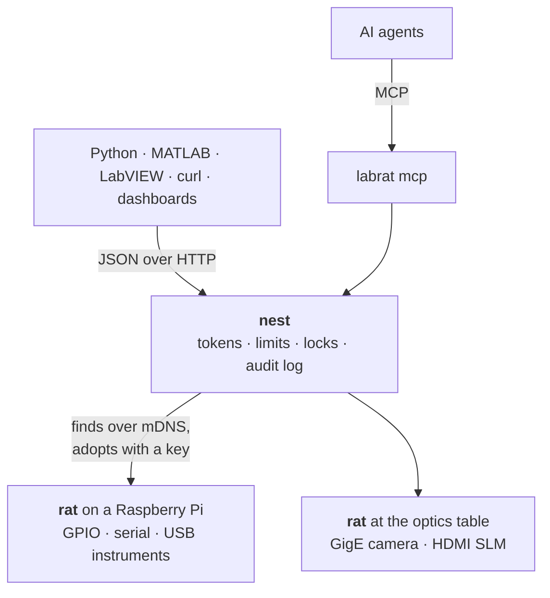

<p align="center">
  <picture>
    <source media="(prefers-color-scheme: dark)" srcset="https://raw.githubusercontent.com/reinhardjvv/labrat/main/docs/assets/labrat-dark.svg">
    
  </picture>
</p>

<p align="center">
  <strong>A safe, open interface to lab equipment.</strong><br>
  Power supplies, GPIO, cameras, SLMs and SCPI instruments behind one JSON message, for people, scripts and AI agents.
</p>

<p align="center">
  <a href="https://github.com/reinhardjvv/labrat/actions/workflows/ci.yml"></a>
  <a href="https://pypi.org/project/labrat-lab/"></a>
  <a href="https://pypi.org/project/labrat-lab/"></a>
  <a href="LICENSE"></a>
</p>

<p align="center">
  <a href="#quick-start">Quick start</a> ·
  <a href="docs/install.md">Install</a> ·
  <a href="docs/api.md">Message API</a> ·
  <a href="docs/mcp.md">MCP</a> ·
  <a href="docs/drivers.md">Drivers</a> ·
  <a href="CONTRIBUTING.md">Contributing</a>
</p>

---

LABRAT gives every instrument in a lab the same small interface. A bench supply, a relay on a Raspberry Pi,
a GigE camera and an HDMI spatial light modulator all answer the same JSON messages. Python, MATLAB, LabVIEW,
curl, a microcontroller or an AI agent can drive any of them without a vendor SDK on the client.

Every change is checked against limits that protect the equipment, and a lab's limits can only tighten a
device's own. Anyone can send `stop`, which puts every device in its safe state. A rat that
loses its nest does the same by itself.

## Quick start

```bash
pipx install labrat-lab
labrat demo                                   # a nest with simulated devices, on this computer
```

In a second terminal, with the token the demo printed:

```bash
export LABRAT_URL=http://127.0.0.1:8780 LABRAT_TOKEN=<token>
labrat devices
labrat set psu VoltageLevel 5 --channel 1
labrat set psu VoltageLevel 20 --channel 1    # limit: VoltageLevel 20 V is above the limit of 12 V
labrat stop
```

Any language can send the same message:

```bash
curl -s $LABRAT_URL/api/v1/message -H "Authorization: Bearer $LABRAT_TOKEN" \
     -d '{"op": "set", "device": "psu", "name": "VoltageLevel", "channel": "1", "value": 5}'
```

```json
{"ok": true, "value": 5.0, "unit": "V"}
```

## How it fits together



- **The nest** is the lab's server. It holds the tokens, checks every change, keeps locks and writes an
  audit log. Devices on rats appear as `<rat>/<device>`.
- **A rat** is a small computer at the bench. It serves the devices plugged into it, announces itself on the
  network and goes to its safe state when the nest falls silent.
- **The message** is the same everywhere: `list`, `describe`, `get`, `set`, `call`, `lock`, `stop`. Devices
  with continuous data, such as cameras and live readings, add streams.

## What it drives

| Driver | Equipment |
| --- | --- |
| `scpi` | any text-command instrument over TCP, serial or USBTMC, described in a few lines of configuration |
| `gpio` | relays, switches, interlocks and sensors on Linux GPIO lines |
| `camera` | USB and CSI cameras, and PoE or network cameras through their RTSP or MJPEG address (ONVIF cameras included) |
| `genicam` | machine-vision cameras on GigE Vision and USB3 Vision, such as Allied Vision, Basler and FLIR |
| `display` | HDMI spatial light modulators, DMDs and projectors, written straight to the framebuffer |
| `sim-supply`, `sim-gpio` | simulated devices for learning, demonstrations and tests |

New drivers are one Python class each, and other packages can add their own through an entry point
([docs/drivers.md](docs/drivers.md)).

## Use it from

| | |
| --- | --- |
| **Python** | `Client().set("bench-rat/psu", "VoltageLevel", 3.3, channel="1")` ([clients](docs/clients.md#python)) |
| **MATLAB** | `webwrite` with a bearer token, or [`examples/matlab/labrat.m`](examples/matlab/labrat.m) ([clients](docs/clients.md#matlab)) |
| **AI agents** | `claude mcp add labrat -- labrat mcp` ([MCP](docs/mcp.md)) |
| **Anything else** | one HTTP endpoint and JSON ([message API](docs/api.md)) |

## Set up a lab

| Step | Where | Command |
| --- | --- | --- |
| 1 | the server | `sudo ./packaging/install.sh nest` ([install](docs/install.md#the-nest)) |
| 2 | each bench computer | `sudo ./packaging/install.sh rat` ([install](docs/install.md#a-rat)) |
| 3 | anywhere | `labrat find` lists the rats on the network |
| 4 | anywhere | `labrat adopt <rat>` adds one to the nest, with the key the rat shows |

Recommended systems: Ubuntu Server LTS or Debian for the nest, Raspberry Pi OS Lite (64-bit) for rats
([which computer and which OS](docs/install.md#choosing-hardware-and-an-operating-system)).

## Documentation

| | |
| --- | --- |
| [Architecture](docs/architecture.md) | the nest, rats, messages and how they find each other |
| [Install](docs/install.md) | hardware, operating systems, the nest and the rats |
| [Configuration](docs/configuration.md) | `nest.toml`, `rat.toml`, devices, limits and tokens |
| [Message API](docs/api.md) | every operation, error code and route |
| [Rat protocol](docs/rat-protocol.md) | what firmware must do to be a rat, for ESP32 and other boards |
| [Clients](docs/clients.md) | Python, MATLAB, curl, JavaScript and LabVIEW |
| [MCP](docs/mcp.md) | AI agents through the Model Context Protocol |
| [Drivers](docs/drivers.md) | the built-in drivers and how to write one |
| [Safety and security](docs/safety.md) | limits, safe states, the watchdog, tokens and the network |
| [Roadmap](docs/roadmap.md) | what comes next |

## Contributing

Drivers, client libraries, documentation and bug reports are all welcome. [CONTRIBUTING.md](CONTRIBUTING.md)
explains the workflow and the house rules. A maintainer reviews every pull request, with an automated review
as advice on branches of this repository. Report security issues privately, as [SECURITY.md](SECURITY.md) describes.

## Licence

LABRAT is released under the [Apache License 2.0](LICENSE).
