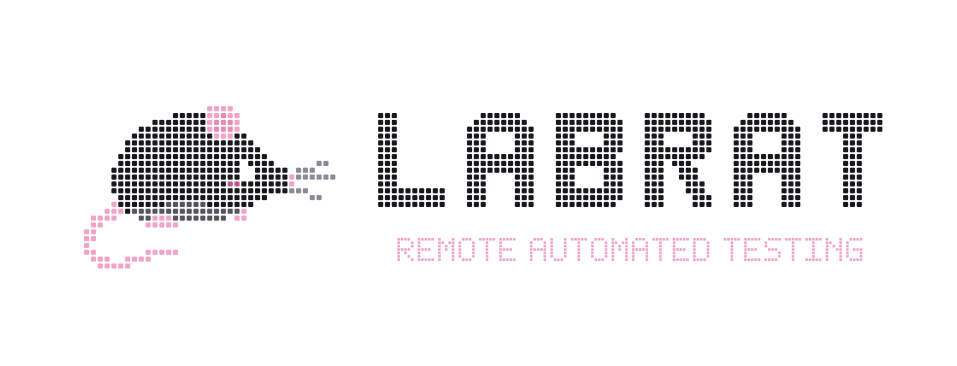
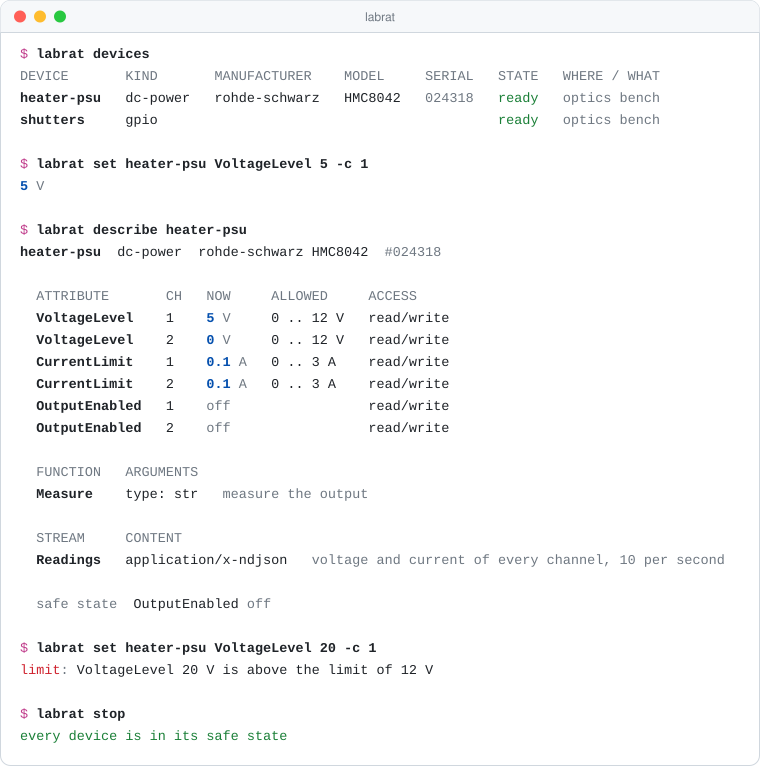
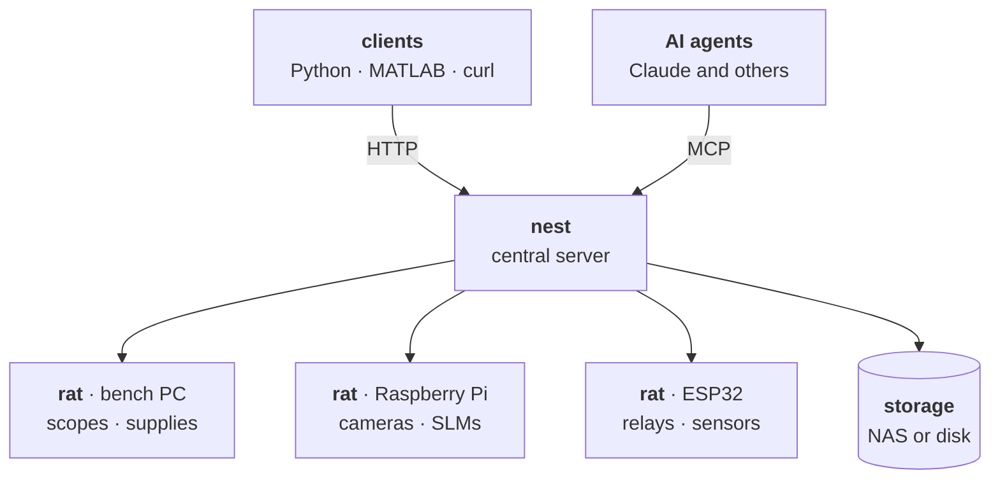

<p align="center">
  <picture>
    <source media="(prefers-color-scheme: dark)" srcset="docs/assets/labrat-dark.svg">
    
  </picture>
</p>

<h3 align="center">A universal interface for lab automation</h3>

<p align="center"><i>Let the rat run the maze.</i></p>

<p align="center">
  Control oscilloscopes, signal generators, VNAs, spectrum analysers, power supplies, cameras and more through one API.
</p>

<p align="center">
  <a href="https://github.com/reinhardjvv/labrat/actions/workflows/ci.yml"></a>
  <a href="https://pypi.org/project/labrat-lab/"></a>
  <a href="https://pypi.org/project/labrat-lab/"></a>
  <a href="docs/mcp.md"></a>
  <a href="LICENSE"></a>
</p>

> [!NOTE]
> LABRAT is in early development. The message API and the configuration may still change before 1.0, and
> each change is listed in the [changelog](CHANGELOG.md).

<p align="center">
  <a href="#quick-start"><b>Quick start</b></a> ·
  <a href="docs/install.md"><b>Install</b></a> ·
  <a href="docs/api.md"><b>API</b></a> ·
  <a href="docs/mcp.md"><b>MCP</b></a> ·
  <a href="docs/drivers.md"><b>Drivers</b></a> ·
  <a href="CONTRIBUTING.md"><b>Contributing</b></a>
</p>

<p align="center">
  <picture>
    <source media="(prefers-color-scheme: dark)" srcset="docs/assets/terminal-dark.svg">
    
  </picture>
</p>

## Quick start

```bash
pipx install git+https://github.com/reinhardjvv/labrat.git
labrat demo                       # start a demo lab with simulated instruments
```

In a second terminal, with the token the demo prints:

```bash
export LABRAT_URL=http://127.0.0.1:8780 LABRAT_TOKEN=<token>
labrat describe psu
labrat shell                      # an interactive prompt with tab completion
```

Connect Claude, or any MCP client, to the same lab:

```bash
claude mcp add labrat -e LABRAT_URL=$LABRAT_URL -e LABRAT_TOKEN=$LABRAT_TOKEN -- labrat mcp
```

Every client sends the same message, so curl works too:

```bash
curl -s $LABRAT_URL/api/v1/message -H "Authorization: Bearer $LABRAT_TOKEN" \
     -d '{"op": "set", "device": "psu", "name": "VoltageLevel", "channel": "1", "value": 5}'
```

## Ask your agent

With LABRAT connected over MCP, Claude or another agent works the bench the way a person would:

```text
Start an experiment called filter-check. Sweep the generator from 1 to 20 MHz in 1 MHz steps, take a scope
trace at each step, and tell me where the response is 3 dB down.
```

The agent finds the instruments, locks them, opens an experiment in your folder, runs the sweep and reads its
own data back. The lab's limits, locks and approvals apply to every request, and every command is logged
under the agent's token. Give it as much freedom as you want ([MCP](docs/mcp.md)).

## The nest and the rats


A lab has one **nest** and any number of **rats**. The nest is the server everyone talks to. It holds the
tokens, the limits, the locks and the audit log. The rats sit at the benches next to the equipment, and each
one serves whatever is plugged into it. A rat can be any Linux computer, from a single-board computer to the
PC already beside an instrument, or a microcontroller that speaks the [rat protocol](docs/rat-protocol.md).
A small lab can run the nest alone, with its devices plugged straight in.



## What it works with

| Equipment | Connected by |
| --- | --- |
| Oscilloscopes, signal and function generators, VNAs, spectrum analysers, power supplies, multimeters, source meters and other bench instruments | Ethernet, USB or RS-232, through their standard SCPI commands |
| Cameras: USB webcams, PoE and network cameras, machine-vision cameras such as Allied Vision, Basler and FLIR | USB, RTSP, MJPEG, GigE Vision or USB3 Vision |
| Spatial light modulators, DMDs and projectors | HDMI |
| Relays, shutters, interlocks, switches and sensors | GPIO pins on a rat |
| Sensors, ADCs, DACs and port expanders | I2C on a rat |
| Pumps, stages, controllers and Arduino boards with their own commands | serial, or a serial server on the network |
| Smart lights and plugs, ESP32 boards and anything on a broker or a web API | MQTT or HTTP |
| Uninterruptible power supplies | Network UPS Tools |
| Modbus meters and controllers, and devices with their own binary frames | serial or TCP |
| Anything else with a programming interface | a profile worked out with `labrat probe`, or a driver of a few dozen lines of Python |

A bench instrument needs no code. Its commands go in a few lines of configuration
([drivers](docs/drivers.md)), and simulated devices let you try everything without hardware.

## Use it from

| | |
| --- | --- |
| **Python** | `Client().set("bench-rat/psu", "VoltageLevel", 3.3, channel="1")` ([clients](docs/clients.md#python)) |
| **MATLAB** | `webwrite` with a bearer token, or [`examples/matlab/labrat.m`](examples/matlab/labrat.m) ([clients](docs/clients.md#matlab)) |
| **AI agents** | `claude mcp add labrat -- labrat mcp` ([MCP](docs/mcp.md)) |
| **Anything else** | one HTTP endpoint and JSON ([message API](docs/api.md)) |

## Set up a lab

| Step | Where | Command |
| --- | --- | --- |
| 1 | the server | `sudo ./packaging/install.sh nest` ([install](docs/install.md#the-nest)) |
| 2 | each bench computer | `sudo ./packaging/install.sh rat` ([install](docs/install.md#a-rat)) |
| 3 | anywhere | `labrat find` lists the rats on the network |
| 4 | anywhere | `labrat adopt <rat>` adds one to the nest, with the key the rat shows |

Any 64-bit Linux runs a nest or a rat. Good defaults are Ubuntu Server LTS or Debian for the nest, and
Raspberry Pi OS Lite (64-bit), DietPi or Armbian for rats on single-board computers
([which computer and which OS](docs/install.md#choosing-hardware-and-an-operating-system)).

## Questions

**Does it replace PyVISA, LabVIEW or my scripts?** No. LABRAT sits between them and the equipment, so every
script, notebook and agent sees the same instruments through the same limits and locks. LabVIEW and MATLAB
talk to it over HTTP.

**Do I need a Raspberry Pi?** No. A small lab runs the nest alone on one computer, with its instruments on the
network or plugged in. Rats are for equipment that is spread over benches or needs local USB, GPIO or I2C.

**What about a device nobody supports?** Plug it in and run `labrat probe`, or ask your agent to work it
out. LABRAT asks it safe questions, records what its vendor software says to it, and turns that into a
profile, a short file that makes it a normal device. The next lab with the same model gets it from the
catalog ([catalog](docs/catalog.md)).

**Is it safe to let an agent drive real equipment?** The guardrails are yours to set: limits on every
setting, locks, requests that wait for a person, and one stop that puts the whole lab in its safe state. A
rat that loses the nest does the same by itself.

**Is there a web dashboard?** Not yet. The terminal, the Python client and MCP cover everything today, and a
dashboard will use the same API.

**Can two people use the same instrument?** Not at the same time, if they lock it. `labrat lock` makes a
device yours until you let go, `labrat who` shows who holds what, and `require_lock` makes a lock necessary
before any change. People are added with `labrat user add`, with no restart.

**Where does my data go?** Wherever you point it: a local disk or a NAS, in a folder per person and
experiment ([experiments](docs/experiments.md)).

## Documentation

| | |
| --- | --- |
| [Architecture](docs/architecture.md) | the nest, rats, messages and how they find each other |
| [Install](docs/install.md) | hardware, operating systems, the nest and the rats |
| [Configuration](docs/configuration.md) | `nest.toml`, `rat.toml`, devices, limits and tokens |
| [Message API](docs/api.md) | every operation, error code and route |
| [Rat protocol](docs/rat-protocol.md) | what firmware must do to be a rat, for ESP32 and other boards |
| [Clients](docs/clients.md) | Python, MATLAB, curl, JavaScript and LabVIEW |
| [MCP](docs/mcp.md) | AI agents through the Model Context Protocol |
| [Drivers](docs/drivers.md) | the built-in drivers and how to write one |
| [Recordings](docs/recordings.md) | readings, waveforms and streams written to storage on a schedule |
| [Catalog and reverse engineering](docs/catalog.md) | device profiles, scanning, probing and capturing unknown devices |
| [Experiments](docs/experiments.md) | each person's work in their own folder, with its commands, settings, notes and recordings |
| [Names and selectors](docs/naming.md) | ids, identities, the standard kinds, and finding devices by type, maker or serial |
| [Safety and security](docs/safety.md) | limits, safe states, the watchdog, tokens and the network |
| [Roadmap](docs/roadmap.md) | what comes next |

## Contributing

Drivers, client libraries, documentation and bug reports are all welcome. [CONTRIBUTING.md](CONTRIBUTING.md)
explains the workflow and the house rules. A maintainer reviews every pull request, with an automated review
as advice on branches of this repository. Report security issues privately, as [SECURITY.md](SECURITY.md) describes.

## Licence

LABRAT is released under the [Apache License 2.0](LICENSE).
